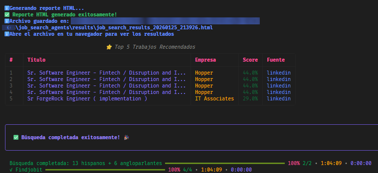

# 🚀 LangGraph Agent System for Job Search

<div align="center">

      

</div>

---

<div align="center">

**Intelligent job search system that uses LangGraph agents to search for jobs across multiple sources, extract contact information, and generate an interactive HTML report.**

</div>

---

## 🆕 **NEW LLM-ENHANCED FEATURES (v2.0)**

<div style="background-color: #e3f2fd; border: 2px solid #2196F3; border-radius: 8px; padding: 20px; margin: 20px 0;">

The system now includes LLM-enhanced capabilities that make searches **significantly smarter**:

- **🎯 Adaptive Keywords**: LLM generates optimized keywords for each source and region based on your profile
- **🧠 Semantic Matching**: Deep relevance analysis beyond simple keywords
- **🔄 Hybrid Approach**: Combines fast heuristic matching with intelligent semantic analysis
- **🌍 Regional Adaptation**: Keywords and analysis specific to Hispanic vs English-speaking regions

</div>

---

## ⚡ **QUICK START** ⚡

```bash
# 1. Install dependencies
pip install -r requirements.txt

# 2. Install Playwright
playwright install chromium

# 3. Configure your private environment and search preferences
cp env.example .env
cp config/local_search.example.yaml config/local_search.yaml

# 4. 🚀 START THE SYSTEM
python main.py
```

**✨ Ready! The system will start searching for jobs automatically**

---

Search duration varies with enabled sources, network conditions, result volume, and LLM provider. Follow the terminal progress; the HTML report is written when the workflow finishes.

---

## 🎯 Features

<div align="center">

### 🔍 Supported Job Sources

    

</div>

- **🔍 Multi-Source Search**: Supports LinkedIn and Computrabajo for local Colombia searches, plus configurable remote/global sources
- **🤖 Specialized Agents**: Each source has its own agent and source-specific request handling
- **🇨🇴 Computrabajo**: Colombia-focused source, disabled by default; enable it in `config/local_search.yaml`. The collector stops when it encounters access-denied, rate-limit, or challenge responses.
- **📧 Intelligent Email Extraction**: Uses LLMs to extract contact emails from job descriptions
- **🎯 Intelligent Matching**: Calculates match score between jobs and your profile using heuristic matching + deep semantic analysis with LLM (hybrid)
- **🤖 Adaptive Keywords**: Dynamically generates optimized keywords by source and region using LLM (NEW)
- **🧠 Semantic Analysis**: Intelligent semantic matching that understands synonyms and real context (NEW)
- **📊 Interactive HTML Report**: Generates an HTML report with filters, statistics, and visualizations
- **🔄 LangGraph Architecture**: Coordinated workflow using LangGraph StateGraph for agent orchestration
- **🛡️ Anti-Bot Protection**: Advanced system with User-Agent rotation, circuit breakers, adaptive rate limiting, and more
- **⚙️ Flexible Configuration**: Environment variables to fully customize system behavior
- **✅ Comprehensive Testing**: Full test suite with pytest for unit testing and validation
- **🏗️ Clean Architecture**: Modular design with shared utilities, base classes, and proper error handling
- **📊 Configuration Validation**: Pydantic models for type-safe configuration validation
- **🎯 Agent Skills System**: LLM prompts organized as reusable skills following the agent-skills standard, enabling easy prompt management, versioning, and experimentation

## 🛠️ Tech Stack

<div align="center">

### Frameworks & Libraries

   

### LLM Providers

 

### Data & Config

  

### Web Technologies

  

</div>

## 📋 Requirements

<div align="center">

   

</div>

- **Python 3.9+**
- **OpenAI or Anthropic API Key** (for LLMs)
- **Playwright** (for web scraping)
- **Resume file in Markdown format** (or configure the path in environment variables)

## 🚀 Quick Installation

### 1️⃣ Clone or navigate to the project directory

```bash
cd job_search_agents
```

### 2️⃣ Install dependencies

```bash
pip install -r requirements.txt
```

### 3️⃣ Install Playwright browsers

```bash
playwright install chromium
```

### 4️⃣ Configure environment variables

Copy the example file and customize it:

```bash
# Windows
copy env.example .env

# Linux/Mac
cp env.example .env
```

Then edit the `.env` file with your values. **See Environment Variables section** for more details.

### 5️⃣ Configure user profile

Copy the profile example file:

```bash
# Windows
copy data\profile.json.example data\profile.json

# Linux/Mac
cp data/profile.json.example data/profile.json
```

Edit `data/profile.json` with your personal and professional information.

## ⚙️ Detailed Initial Configuration

### 📝 Required Environment Variables

Required values are `USER_EMAIL`, `USER_PHONE`, and the credential for the selected LLM provider. Hugging Face endpoint, model, route, and timeout values have defaults and can be overridden when needed.

| Variable | Description | Example |
|----------|-------------|---------|
| `USER_EMAIL` | Your contact email | `your_email@example.com` |
| `USER_PHONE` | Your phone (with country code) | `+1234567890` |
| `HF_TOKEN` | Hugging Face token (if `LLM_PROVIDER=huggingface`) | `hf_...` |
| `OPENAI_API_KEY` | OpenAI key (if `LLM_PROVIDER=openai`) | `sk-...` |
| `ANTHROPIC_API_KEY` | Anthropic key (if `LLM_PROVIDER=anthropic`) | `sk-ant-...` |

Provider-specific credentials are conditional: configure only the key for your selected `LLM_PROVIDER`. Hugging Face options such as `HF_API_BASE_URL`, `HF_PLANNER_MODEL`, `HF_EXTRACTOR_MODEL`, `HF_MODEL_ROUTE`, and `HF_TIMEOUT_SECONDS` are optional overrides with defaults.

### 🔑 API Key Configuration

#### To use Hugging Face Inference:

```env
LLM_PROVIDER=huggingface
HF_TOKEN=your_huggingface_token_here
HF_API_BASE_URL=https://router.huggingface.co/v1
HF_PLANNER_MODEL=moonshotai/Kimi-K3
HF_EXTRACTOR_MODEL=Qwen/Qwen3.6-27B
HF_MODEL_ROUTE=fastest
HF_TIMEOUT_SECONDS=90
```

Set `HF_TOKEN` to a Hugging Face token with access to the Inference Router.

#### To use OpenAI:

```env
LLM_PROVIDER=openai
OPENAI_API_KEY=your_api_key_here
LLM_MODEL=gpt-4o-mini
```

Get your API key at: https://platform.openai.com/api-keys

### 📄 Resume Configuration

The system looks for your resume at the configured path. You can specify it in two ways:

#### Option 1: Absolute path (recommended for Windows)

```env
CV_PATH=C:\Users\YourUser\Documents\cv\resume.md
```

#### Option 2: Relative path (portable)

```env
CV_PATH=../cv/resume.md
```

#### Option 3: Default value

If you don't specify `CV_PATH`, the system will use:
```
cv/resume.md
```
inside the project. The `cv/` directory is excluded from Git to prevent
publishing personal resumes. Relative `CV_PATH`, `OUTPUT_DIR`, and `DATA_DIR`
values resolve from the project root.

## 📚 Complete Environment Variables

The `env.example` file contains all available variables with complete documentation. Here's a summary by category:

### 🔐 API Keys and LLM

| Variable | Required | Description |
|----------|----------|-------------|
| `HF_TOKEN` | If `LLM_PROVIDER=huggingface` | Hugging Face token |
| `OPENAI_API_KEY` | If `LLM_PROVIDER=openai` | OpenAI API key |
| `LLM_PROVIDER` | Yes | `huggingface`, `openai`, or `anthropic` |
| `LLM_MODEL` | No (default: `gpt-4o-mini`) | Model to use |

### 👤 User Profile

| Variable | Required | Description |
|----------|----------|-------------|
| `USER_EMAIL` | ✅ **Yes** | Contact email |
| `USER_PHONE` | ✅ **Yes** | Phone with country code |

### 🔍 Search Configuration

| Variable | Default | Description |
|----------|---------|-------------|
| `MAX_JOBS_PER_SOURCE` | `50` | Maximum jobs per source |
| `MIN_MATCH_SCORE` | `60` | Minimum score to consider relevant (0-100) |
| `SEARCH_TIMEOUT` | `30` | Timeout in seconds |
| `FAST_MODE` | `false` | Enable fast mode (reduced delays, disabled human simulation) |
| `EMAIL_EXTRACTION_CONCURRENCY` | `10` | Number of parallel email extractions |
| `EMAIL_BATCH_SIZE` | `5` | Batch size for email extraction |

### 🕷️ Scraping Configuration

| Variable | Default | Description |
|----------|---------|-------------|
| `SCRAPING_DELAY` | `2.0` | Delay between requests (seconds) |
| `MAX_RETRIES` | `3` | Maximum number of retries |
| `HEADLESS_BROWSER` | `true` | Run browser without interface |
| `PAGE_LOAD_TIMEOUT` | `30000` | Page load timeout in milliseconds |
| `SELECTOR_TIMEOUT` | `10000` | Selector timeout in milliseconds |
| `REQUEST_TIMEOUT` | `30` | HTTP request timeout in seconds |
| `DESCRIPTION_MAX_LENGTH` | `2000` | Maximum length for job descriptions |
| `TITLE_DISPLAY_LENGTH` | `50` | Maximum display length for job titles |

### 🛡️ Basic Anti-Bot Configuration

| Variable | Default | Description |
|----------|---------|-------------|
| `USE_USER_AGENT_ROTATION` | `true` | Rotate User-Agent automatically |
| `RANDOM_DELAY_ENABLED` | `true` | Random delays between requests |
| `MIN_DELAY` | `1.5` | Minimum delay (seconds) |
| `MAX_DELAY` | `4.0` | Maximum delay (seconds) |
| `ENABLE_BROWSER_STEALTH` | `true` | Browser stealth mode |
| `SIMULATE_HUMAN_BEHAVIOR` | `true` | Simulate human behavior |

### 🔧 Advanced Anti-Bot Configuration

| Variable | Default | Description |
|----------|---------|-------------|
| `USE_CIRCUIT_BREAKER` | `true` | Enable circuit breaker |
| `CIRCUIT_BREAKER_THRESHOLD` | `5` | Errors before activating |
| `CIRCUIT_BREAKER_TIMEOUT` | `300` | Circuit breaker timeout (seconds) |
| `USE_SESSION_PERSISTENCE` | `true` | Maintain persistent sessions |
| `USE_ADAPTIVE_RATE_LIMITING` | `true` | Adaptive rate limiting |
| `USE_REFERER_HEADERS` | `true` | Use Referer headers |
| `USE_SESSION_WARMUP` | `true` | Session warm-up before scraping |
| `USE_QUERY_VARIATIONS` | `true` | Generate query variations with LLM |

### 🤖 LLM-Enhanced Configuration (NEW)

| Variable | Default | Description |
|----------|---------|-------------|
| `USE_ADAPTIVE_KEYWORDS` | `true` | Generate adaptive keywords by source/region with LLM |
| `USE_SEMANTIC_MATCHING` | `true` | Deep semantic relevance analysis with LLM |
| `SEMANTIC_MATCHING_THRESHOLD` | `50` | Minimum heuristic score for semantic analysis (0-100) |
| `SEMANTIC_MAX_JOBS` | `100` | Maximum jobs to analyze semantically |
| `SEMANTIC_WEIGHT` | `0.6` | Weight of semantic score in final score (0-1) |
| `HEURISTIC_WEIGHT` | `0.4` | Weight of heuristic score in final score (0-1, must sum 1.0 with SEMANTIC_WEIGHT) |

### 📁 Path Configuration

| Variable | Default | Description |
|----------|---------|-------------|
| `CV_PATH` | `cv/resume.md` | Path to resume file |
| `OUTPUT_DIR` | `results` | Output directory, relative to the project root |
| `DATA_DIR` | `data` | Data directory, relative to the project root |

### 📝 Logging Configuration

| Variable | Default | Description |
|----------|---------|-------------|
| `LOG_LEVEL` | `INFO` | Level: `DEBUG`, `INFO`, `WARNING`, `ERROR`, `CRITICAL` |
| `LOG_FILE` | (optional) | Log file (if not specified, console only) |

### 💾 Cache Configuration

| Variable | Default | Description |
|----------|---------|-------------|
| `USE_CACHE` | `true` | Enable cache |
| `CACHE_EXPIRY_HOURS` | `24` | Cache expiration (hours) |

### 🔗 Job Board API Keys (Optional)

| Variable | Description |
|----------|-------------|
| `LINKEDIN_API_KEY` | Official LinkedIn API key |
| `REMOTEOK_API_KEY` | RemoteOK API key (premium) |

## 📖 Usage

### 🚀 Start the System

<div align="center">

### ⚡ **MAIN COMMAND** ⚡

```bash
python main.py
```

**🎯 Run this command to start the job search**

</div>

---

The system will execute the following flow:

1. ✅ **Validate configuration**: Verify that all required variables are configured
2. 📄 **Parse your resume**: Extract information from your resume from the configured path
3. 🔍 **Search for jobs**: Query all enabled sources in parallel
4. 📧 **Extract emails**: Use LLMs to find contact emails in job descriptions
5. 🎯 **Calculate matches**: Compare each job with your profile and assign a score
6. 📊 **Generate report**: Create an interactive HTML file with results

### Example Output



*Example of the final output showing the HTML report generation, top 5 recommended jobs, search statistics, and total execution time (approximately 1 hour and 4 minutes in this example).*

## 📂 Project Structure

```
job_search_agents/
├── agents/                      # 🤖 Specialized agents
│   ├── orchestrator.py          # Main orchestrator (LangGraph)
│   ├── linkedin_agent.py        # LinkedIn agent
│   ├── computrabajo_agent.py    # Computrabajo Colombia agent
│   ├── indeed_agent.py          # Indeed agent (disabled)
│   ├── remote_jobs_agent.py     # Remote jobs agent
│   ├── tech_jobs_agent.py       # Tech jobs agent
│   ├── findjobit_agent.py       # Findjobit agent (LATAM)
│   ├── email_extractor_agent.py # Email extraction
│   └── matcher_agent.py         # Profile matching
│   ├── cv_parser.py             # Resume parser
│   ├── html_generator.py         # HTML generator
│   ├── user_agent_rotator.py    # User-Agent rotation
│   ├── circuit_breaker.py       # Circuit breaker pattern
│   ├── adaptive_rate_limiter.py # Adaptive rate limiting
│   ├── url_utils.py             # URL utilities
│   ├── http_helpers.py          # HTTP helper functions
│   ├── job_enricher.py          # Job enrichment utilities
│   ├── exceptions.py            # Custom exceptions
│   └── ...                      # More anti-bot utilities
├── config/                      # ⚙️ Configuration
│   ├── settings.py               # System configuration
│   ├── validators.py            # Pydantic validators
│   ├── config_loader.py         # YAML config loader
│   ├── job_sources.yaml         # Public default values
│   └── local_search.example.yaml # Example local preferences
├── tools/                       # 🛠️ Support tools
│   ├── web_scraper.py           # Advanced web scraping
│   ├── base_api_client.py       # Base API client class
│   ├── api_clients.py            # API clients
│   ├── email_validator.py        # Email validation
│   └── http_client_strategy.py   # HTTP strategies
├── tests/                       # 🧪 Test suite
│   ├── conftest.py              # Pytest fixtures
│   ├── test_agents/             # Agent tests
│   ├── test_utils/              # Utility tests
│   └── test_config/             # Configuration tests
├── templates/                   # 📄 HTML templates
│   └── results_template.html
├── skills/                      # 🎯 Agent Skills (LLM prompts)
│   ├── email-extractor/         # Skill: email extraction
│   ├── query-variator/          # Skill: query variations
│   ├── keyword-generator/       # Skill: adaptive keywords (NEW)
│   └── semantic-matcher/        # Skill: semantic matching (NEW)
│   ├── email-extractor/         # Email extraction skill
│   │   └── SKILL.md
│   ├── job-matcher/             # Job matching skill
│   │   └── SKILL.md
│   ├── query-variator/           # Query variation skill
│   │   └── SKILL.md
│   └── README.md                # Skills documentation
├── data/                        # 💾 Data
│   ├── profile.json.example     # Profile example
│   └── profile.json              # Your profile (not uploaded to repo)
├── results/                      # 📊 HTML results
├── main.py                      # 🚀 Entry point
├── env.example                  # 📋 Environment variables example
├── .env                         # 🔐 Your variables (not uploaded to repo)
├── .gitignore                   # Files excluded from repo
└── requirements.txt             # 📦 Dependencies
```

## ⚙️ Advanced Configuration

### 🎯 Customize Search Keywords

**Option 1: Static Keywords (Traditional)**

Customize `config/local_search.yaml` for keywords, location, and sources. Copy
it from `config/local_search.example.yaml`; the local override is ignored by Git.
`config/job_sources.yaml` keeps generic repository defaults.

```yaml
keywords:
  - "AI Engineer"
  - "LLMOps Engineer"
  - "Python Senior Developer"
  - "Machine Learning Engineer"
  # Add more keywords according to your profile
```

**Option 2: Adaptive Keywords with LLM (Recommended - NEW)**

If `USE_ADAPTIVE_KEYWORDS=true` (default), the system will automatically generate optimized keywords for each source and region based on your profile. Keywords from the merged configuration are used as a base and the LLM adapts them dynamically.

Adaptive keywords let the LLM tailor search terms to the profile, source, and region. Results depend on the selected model and configuration.

### 🔄 Filter Job Sources

You can enable/disable sources in `config/local_search.yaml`:

```yaml
job_sources:
  linkedin:
    enabled: true
    max_results: 50
  indeed:
    enabled: false  # Disabled: difficult access
    max_results: 50
  remoteok:
    enabled: false  # Disable this source
```

### 🎚️ Adjust Minimum Score

Control which jobs are shown in the report:

```env
MIN_MATCH_SCORE=70  # Only jobs with score >= 70
```

### 🛡️ Anti-Bot Configuration to Avoid Blocks

If you experience frequent blocks, adjust these variables:

```env
# Increase delays
SCRAPING_DELAY=3.0
MIN_DELAY=2.0
MAX_DELAY=5.0

# Enable all protections
USE_USER_AGENT_ROTATION=true
RANDOM_DELAY_ENABLED=true
ENABLE_BROWSER_STEALTH=true
SIMULATE_HUMAN_BEHAVIOR=true
USE_CIRCUIT_BREAKER=true
```

### 📝 Logging Configuration

For debugging, change the log level:

```env
LOG_LEVEL=DEBUG
LOG_FILE=debug.log
```

### 📁 Customize Directories

```env
# Custom path for results
OUTPUT_DIR=/custom/path/results

# Custom path for data
DATA_DIR=/custom/path/data
```

## 📊 Output

The system generates the following files:

### 1. 📄 Interactive HTML Report

File generated at `results/job_search_results_YYYYMMDD_HHMMSS.html` with:

- ✅ **Executive summary**: General statistics
- 📋 **Jobs table**: Sorted by match score
- 🔍 **Interactive filters**: By source, score, keywords
- 📧 **Consolidated email list**: All emails found
- 📈 **Statistics by source**: Job distribution
- 🎯 **Top recommended jobs**: Best matches

### 2. 📝 Profile JSON File

`data/profile.json` with profile extracted from resume (generated automatically).

### 3. 📋 Logs

- **Console**: Real-time progress
- **File** (if `LOG_FILE` is configured): Complete log for analysis

## 🔧 Troubleshooting

### ❌ Error: "USER_EMAIL environment variable is required"

**Cause**: Missing required variables configuration.

**Solution**:
1. Make sure you have a `.env` file in the `job_search_agents` directory
2. Copy `env.example` to `.env` if it doesn't exist
3. Configure `USER_EMAIL` and `USER_PHONE` in your `.env`:
   ```env
   USER_EMAIL=your_email@example.com
   USER_PHONE=+1234567890
   ```

### ❌ Error: "ANTHROPIC_API_KEY environment variable is required"

**Cause**: Missing API key for the configured provider.

**Solution**:
- If `LLM_PROVIDER=huggingface`, configure `HF_TOKEN` and the `HF_*` variables
- If `LLM_PROVIDER=openai`, configure `OPENAI_API_KEY`
- If `LLM_PROVIDER=anthropic`, configure `ANTHROPIC_API_KEY`
- Verify that the variable is in your `.env` file

### ❌ Error: "No module named 'langgraph'"

**Cause**: Missing dependencies.

**Solution**:
```bash
pip install -r requirements.txt
```

### ❌ Error: "Playwright browser not found"

**Cause**: Playwright browser not installed.

**Solution**:
```bash
playwright install chromium
```

### ❌ Error: "CV file not found"

**Cause**: The resume file doesn't exist at the configured path.

**Solution**:
1. Verify that the file exists
2. Configure `CV_PATH` in your `.env` with the correct path:
   ```env
   CV_PATH=C:\full\path\to\your\resume.md
   ```
3. Or place your resume at the default path: `cv/resume.md`

### ⚠️ LinkedIn blocking requests

**Note**: Indeed is disabled by default due to frequent blocks.

**Cause**: Too many requests or bot detection.

**Solution**:
1. Increase delays:
   ```env
   SCRAPING_DELAY=5.0
   MIN_DELAY=3.0
   MAX_DELAY=8.0
   ```
2. Enable all anti-bot protections
3. Consider using official APIs if available
4. Reduce `MAX_JOBS_PER_SOURCE` to make fewer requests

### ⚠️ Search timeout

**Cause**: Timeout too short or slow connection.

**Solution**:
```env
SEARCH_TIMEOUT=60  # Increase timeout to 60 seconds
```

### ⚠️ Empty results

**Cause**: Keywords too specific or disabled sources.

**Solution**:
1. Review `config/local_search.yaml` and verify that sources are enabled
2. Adjust keywords to be more general
3. Reduce `MIN_MATCH_SCORE` to see more results

## 🧪 Testing

The project includes a comprehensive test suite using pytest. Run tests to verify functionality:

### Run All Tests

```bash
pytest
```

### Run Tests with Coverage

```bash
pytest --cov=. --cov-report=html
```

### Run Specific Test Categories

```bash
# Test utilities
pytest tests/test_utils/

# Test agents
pytest tests/test_agents/

# Test configuration
pytest tests/test_config/
```

### Test Structure

- **`tests/conftest.py`**: Shared fixtures and test configuration
- **`tests/test_utils/`**: Tests for utility functions (URL utils, HTTP helpers, job enricher, etc.)
- **`tests/test_agents/`**: Tests for agent functionality (email extractor, matcher, etc.)
- **`tests/test_config/`**: Tests for configuration validation

## 🎯 Agent Skills System

The project uses an **Agent Skills** system inspired by the [agent-skills standard](https://agentskills.io) to organize and manage LLM prompts. This approach separates business logic from LLM instructions, making prompts easier to maintain, version, and experiment with.

### What are Skills?

Skills are reusable instruction sets stored in `SKILL.md` files with YAML frontmatter. Each skill contains:
- **Metadata**: Name, description, version, tags
- **System Message**: Instructions for the LLM's role
- **Human Message Template**: User input template with variables
- **Documentation**: Usage examples, input/output specifications, and best practices

### Available Skills

The system includes the following skills:

- **`email-extractor`**: Extracts contact emails from job descriptions using intelligent LLM analysis. Used by `EmailExtractorAgent`.
- **`query-variator`**: Generates natural variations of search queries to appear more human-like. Used by `QueryVariator` utility.
- **`keyword-generator`**: Generates search keywords dynamically adapted to profile, source, and region. Used by `KeywordGeneratorAgent`. (NEW)
- **`semantic-matcher`**: Semantically analyzes relevance between jobs and candidate profile. Used by `SemanticMatcherAgent`. (NEW)

### Benefits of the Skills System

1. **Separation of Concerns**: Business logic is separated from LLM instructions
2. **Easy Maintenance**: Update prompts without modifying Python code
3. **Better Documentation**: Each skill documents its purpose, usage, and examples
4. **Experimentation**: Test different prompt variations easily
5. **Versioning**: Skills can be versioned independently
6. **Reusability**: Skills can be shared between agents

### Using Skills in Code

Agents load skills using the `SkillLoader` utility:

```python
from utils.skill_loader import SkillLoader

# Initialize loader
skill_loader = SkillLoader()

# Load a skill and get a ChatPromptTemplate
prompt_template = skill_loader.load_skill("email-extractor")

# Use with LangChain
chain = prompt_template | llm | output_parser
result = chain.invoke({
    "description": job_description,
    "format_instructions": parser.get_format_instructions()
})
```

### Creating a New Skill

1. Create a directory in `skills/` with the skill name (e.g., `skills/my-skill/`)
2. Create a `SKILL.md` file with YAML frontmatter:

```markdown
---
name: my-skill
description: What this skill does
version: 1.0.0
agent: langgraph
tags:
  - tag1
  - tag2
---

# My Skill

## System Message

Your system instructions here...

## Human Message Template

Your template with {variables} here...
```

3. Use the skill in your agent:

```python
from utils.skill_loader import SkillLoader

skill_loader = SkillLoader()
self.prompt_template = skill_loader.load_skill("my-skill")
```

### Skill Loader API

The `SkillLoader` class provides several useful methods:

```python
# Load a skill
prompt = skill_loader.load_skill("email-extractor")

# Get skill metadata
metadata = skill_loader.get_skill_metadata("email-extractor")

# List all available skills
skills = skill_loader.list_available_skills()

# Validate a skill
is_valid, error = skill_loader.validate_skill("email-extractor")

# Clear cache
skill_loader.clear_cache()
```

### Skill File Structure

Each skill directory should contain:
- `SKILL.md`: Main skill file with frontmatter and instructions
- Optional: Additional documentation, examples, or reference files

### Best Practices

- **Version your skills**: Use semantic versioning in the frontmatter
- **Document thoroughly**: Include usage examples and variable descriptions
- **Test prompts**: Validate skills before deploying
- **Keep skills focused**: One skill should handle one specific task
- **Use descriptive names**: Skill names should clearly indicate their purpose

## 🎨 Customization

### 🎨 Modify HTML Template

Edit `templates/results_template.html` to customize the report design. The template uses HTML, CSS, and vanilla JavaScript.

### ➕ Add New Job Source

1. Create a new agent in `agents/` (e.g., `new_source_agent.py`)
2. Create API client in `tools/api_clients.py` inheriting from `BaseAPIClient` if necessary:
   ```python
   from tools.base_api_client import BaseAPIClient
   
   class NewSourceClient(BaseAPIClient):
       def __init__(self):
           super().__init__(base_url="https://new-source.com/api")
       
       def search_jobs(self, keywords: List[str], **kwargs) -> List[Dict]:
           # Implementation
   ```
3. Add the agent to the orchestrator in `agents/orchestrator.py`
4. Configure in `config/local_search.yaml`:
   ```yaml
   new_source:
     enabled: true
     max_results: 50
     base_url: "https://new-source.com"
   ```
5. The configuration will be automatically validated using Pydantic models

### 🔧 Customize Profile

Edit `data/profile.json` to reflect your exact profile. This file is used for:
- Job matching
- Relevant information extraction
- Score calculation

### 🎯 Customize LLM Prompts (Skills)

Instead of editing Python code to change LLM prompts, you can now edit the skill files directly:

1. Navigate to `skills/` directory
2. Find the skill you want to modify (e.g., `email-extractor/SKILL.md`)
3. Edit the `## System Message` or `## Human Message Template` sections
4. Save the file - changes take effect immediately (no code changes needed!)

This makes it much easier to:
- Experiment with different prompt strategies
- Fine-tune LLM behavior without touching business logic
- Version prompt changes independently
- Document prompt improvements

Example: To improve email extraction, edit `skills/email-extractor/SKILL.md` and modify the system message instructions.

## 📝 Important Notes

- ⚡ The system respects rate limits and has delays between requests to avoid blocks
- 🔒 LinkedIn has strong anti-scraping protection; may require authentication or official APIs
- 🔄 Some sources may change their HTML structures, requiring code updates
- 🎯 Matching uses keywords and heuristics; for better accuracy, consider using vector embeddings
- 📁 The `.env` and `data/profile.json` files are in `.gitignore` and are not uploaded to the repository
- 🔐 Never share your `.env` file with sensitive information

## 🤝 Contributions

This is a personal project, but improvements are welcome:

- 🐛 **Report bugs**: Open an issue with problem details
- 💡 **Suggest improvements**: Ideas for new features
- 🔧 **Scraping improvements**: Optimizations and new anti-bot techniques
- ➕ **New job sources**: Add more job portals
- 🎯 **Matching improvements**: More accurate algorithms
- ⚡ **Performance optimizations**: Make the system faster

## 📄 License

Personal use.

## 📜 License

This project is licensed under the **Hippocratic License 3.0**, an ethical open source license that allows the use, modification, and distribution of the software with specific restrictions.

### ✅ What does this license allow?

- ✅ Commercial and non-commercial use
- ✅ Modification and creation of derivative works
- ✅ Distribution and sublicensing
- ✅ Private use

### ❌ What does this license prohibit?

The license prohibits the use of the software for:

- ❌ **Aggressive military purposes** or human rights violations
- ❌ **Criminal activities** or illegal acts
- ❌ Violations of fundamental rights (slavery, torture, discrimination, etc.)
- ❌ Illegal environmental damage
- ❌ Any use that violates the ethical standards defined in the Universal Declaration of Human Rights

### 📖 More information

For more details, see the [LICENSE](LICENSE) file or visit [firstdonoharm.dev](https://firstdonoharm.dev/version/3/0/core.html).

**Note**: This license is designed to promote ethical use of software while maintaining open source freedom for legitimate purposes.

---

<div align="center">

**Developed with ❤️ using LangGraph and LangChain for intelligent job search** 🚀

  

**Need help?** Check the [Troubleshooting](#-troubleshooting) section or consult the `env.example` file to see all available configuration options.

</div>
